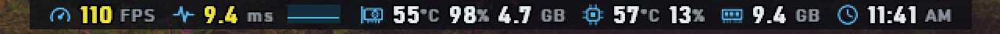

# KkthnxOSD

A single-line performance bar for RivaTuner Statistics Server. Each group gets a small icon, and the numbers only change color when something needs your attention. There's also a tiny frame time graph, because a stutter can hide behind a perfectly good FPS average.



## What it shows

| Group | Values |
| --- | --- |
| FPS | current framerate |
| Frame time | milliseconds plus a 40px graph |
| GPU | temperature, usage, video memory in GB |
| CPU | temperature, usage |
| RAM | system memory in use |
| Clock | local time |

Values stay off-white while things are healthy. They turn yellow, then orange-red, when they cross a threshold.

| Value | Yellow | Orange-red |
| --- | --- | --- |
| FPS | under 120 | under 60 |
| Frame time | over 8.4 ms | over 16.7 ms |
| GPU temperature | 75 °C | 83 °C |
| CPU temperature | 80 °C | 90 °C |

Every sensor comes from RTSS itself, so MSI Afterburner doesn't need to be running. On my PC the built-in readings matched Afterburner within one sampling step.

## Install

You need RTSS 7.3.7 or newer with the OverlayEditor plugin turned on (RTSS, Setup, Plugins, tick `OverlayEditor.dll`).

1. Download [`layout/Kkthnx_OSD_Bar.ovx`](layout/Kkthnx_OSD_Bar.ovx).
2. Open the overlay editor and use Layouts, Import, then pick the file.

Import unpacks the layout and its icon image into RTSS's `Plugins\Client\Overlays` folder and loads it.

To install by hand instead, copy `Kkthnx_OSD_Bar.ovl` and the `Kkthnx_OSD_Bar_Icons_*.png` file from `layout` into that same Overlays folder, then load the `.ovl` from Layouts, Load.

The bar sits at the top center of the screen. It uses Bahnschrift SemiBold at 15px, which ships with Windows 10 and 11.

## Changing it

Everything is generated by [`tools/build_osd.py`](tools/build_osd.py). Colors, thresholds, font size and graph range are plain constants near the top of the file.

You'll need Python 3 with Pillow (`pip install pillow`). Then run this from an elevated PowerShell.

```powershell
.\tools\deploy.ps1
```

That rebuilds `layout`, installs it into RTSS and restarts RTSS so the change shows up. Add `-Preview` to also open RTSS's desktop overlay window full screen, which is handy for checking alignment without a game running.

The `tools` folder also has the small helpers used to tune the bar. `cap.ps1` grabs a screen region, `measure_bar.py` reports the padding around the bar, and `measure_icons.py` checks each icon's vertical center against the digits. `sensor_compare.py` writes a test layout that shows Afterburner and built-in readings side by side.

## Things RTSS does that surprised me

- A running game keeps the first embedded image it loaded under a given file name. The icon file name carries a hash of its contents so an update always reaches games that are already open. Before that, icons showed up shifted into the wrong slots.
- Positive layer margins shrink the background instead of padding it. A negative left margin moves a centered layer sideways, while a negative right margin alone pads both sides evenly.
- Embedded images are drawn from the top of the text line, so each icon sprite is a full line tall with the glyph offset to sit on the digit center.
- Graph values above the graph's maximum are dropped, not clamped. The frame time graph tops out at 50 ms so real stutters still draw.
- An icon atlas 90px wide rendered with sliced icons. Keeping the width a multiple of 16 fixed it.

## License

MIT, see [LICENSE](LICENSE).
